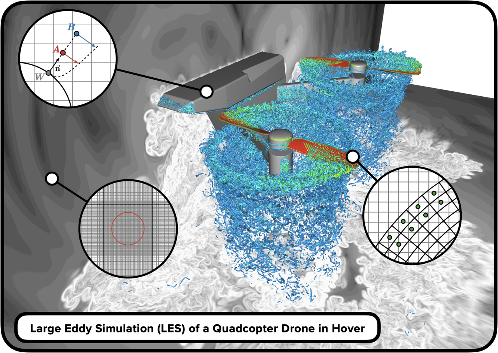

<p align="center">
  
</p>

**A Python toolkit for CFD pre-processing, mesh generation, and post-processing.**


[](https://onera.github.io/Cassiopee/latest/)
[](https://github.com/onera/Cassiopee/releases)
[](LICENSE)
[](https://github.com/onera/Cassiopee/stargazers)


Cassiopee is a collection of 19 Python modules developed by **ONERA, the French Aerospace Lab**, for preparing and analyzing computational fluid dynamics (CFD).

Its modular API provides building blocks for geometry processing, mesh generation and transformation, data conversion, and solution post-processing. Cassiopee is solver-agnostic and supports workflows involving structured and unstructured meshes, including advanced overset grid and immersed boundary methods.


**Explore the documentation, run an example, ask for help, or install Cassiopee using the links below.**

- [Documentation](https://onera.github.io/Cassiopee/latest/)
- [Tutorials](https://github.com/onera/Cassiopee/blob/dev/docs/Tutorials/Tutorials.md) (in construction)
- [Release notes](https://onera.github.io/Cassiopee/latest/ReleaseNotes.html)
- [Report a bug or ask a question](https://github.com/onera/Cassiopee/issues)

<br>

## What can you do with Cassiopee?

Cassiopee provides specialized modules that can be combined into scripts and application-specific workflows. Most functionnalities can operate efficiently in parallel mode, using both shared and distributed memory contexts.

| Module | Main capabilities |
|---|---|
| **Converter** | Read, write, and manipulate CFD data in different formats, including CGNS and Tecplot. |
| **Geom** | Create and manipulate geometric entities. |
| **Generator** | Generate structured and unstructured meshes. |
| **Transform** | Transform and modify meshes. |
| **Intersector** | Perform mesh intersection operations. |
| **Connector** | Build mesh connectivity, including overset-grid connectivity as well as immersed boundary data in a dedicated sub-module. |
| **Initiator** | Initialize solution fields. |
| **Post** | Extract and post-process CFD results, including slices, streamlines, and isosurfaces. |
| **Dist2Walls** | Compute distances to walls and bodies. |
| **Distributor2** | Distribute mesh blocks across processors. |
| **CPlot** | Visualize meshes and solution fields, through the `cassiopee` and `cplot` graphical interfaces. |
| **OCC** | Interface with Open CASCADE for CAD-related operations. |

Additional modules and sub-modules provide capabilities such as rigid-body motion, field compression, and parallel data management. See the [complete documentation](https://onera.github.io/Cassiopee/latest/) for more details.

<br>

## Designed for Python workflows

Cassiopee offers two complementary data interfaces:

This module can manipulate two different data structures: the first one is called an array and is very close to a numpy array, the second one is called a pyTree and it implements the CGNS/python standard.

An array is a simple definition of a mesh using classical numpy arrays.

- **Arrays:** a direct interface for numerical data and mesh operations based on numpy arrays.
- **CGNS/Python tree (pyTrees):** a hierarchical representation of numerical data using lists and numpy arrays, based on the CFD General Notation System (CGNS) standard.

Both interfaces can be accessed directly from Python scripts, to automate repetitive tasks and build reusable CFD workflows.

### A first example

The following script generates a Cartesian mesh and writes it to a CGNS file:

```python
import Generator.PyTree as G
import Converter.PyTree as C

# Generate a Cartesian mesh
zone = G.cart((0., 0., 0.), (0.1, 0.1, 0.1), (11, 11, 11))

# Create a CGNS tree and write it to disk
tree = C.newPyTree(["Base", zone])
C.convertPyTree2File(tree, "mesh.cgns")
```

For more examples, explore the [tutorials](https://github.com/onera/Cassiopee/blob/dev/docs/Tutorials/Tutorials.md) and the tests provided for each Cassiopee module.

<br>

## Installation

Choose the installation method that best fits your environment.

### Install from binaries

#### Linux — pip

```bash
python -m pip install cassiopee  # int32
python -m pip install cassiopee-i8  # int64
```

Binary availability depends on the Python version and target platform. Consult the installation documentation if a compatible package is unavailable.

#### Windows

See the available [Windows releases](https://github.com/onera/Cassiopee/releases).

#### Docker

For a container-based installation, follow the [Docker instructions](https://github.com/onera/Cassiopee/blob/main/docs/developers/Docker/UsingDocker.md).

### Build from source

Source installation is available for supported development environments:

- [Windows — MSYS2](https://github.com/onera/Cassiopee/blob/dev/docs/developers/Install/msys2.md)
- [Linux — Ubuntu](https://github.com/onera/Cassiopee/blob/dev/docs/developers/Install/ubuntu.md)
- [Apple — MacOS] - to come

Building from source may require a suitable compiler toolchain and external libraries. Follow the platform-specific instructions for the required dependencies and environment configuration.

<br>

## Executables

| Application | Description |
|---|---|
| `cassiopee` | Main Graphical User Interface (GUI) for PyTree visualization and pre-/post-processing. |
| `cplot` | Lightweight display application supporting a wide range of mesh and visualization formats. |
| `validCassiopee` | Runs regression tests and CFD validation cases, with local/global reference comparisons and tracking of test status and execution times. |
| `kpython` | Launches Python scripts sequentially or in parallel using MPI and OpenMP, with options for profiling, sanitizers and GNU Debugger (GDB). |
| `kdiff` | Compares two files, supporting a wide range of file formats. |

<br>

## License

Cassiopee is distributed under the **GNU Lesser General Public License v3.0 (LGPL-3.0)**. See [LICENSE](LICENSE) for the full licence text.

<br>

<p align="center">
  
</p>